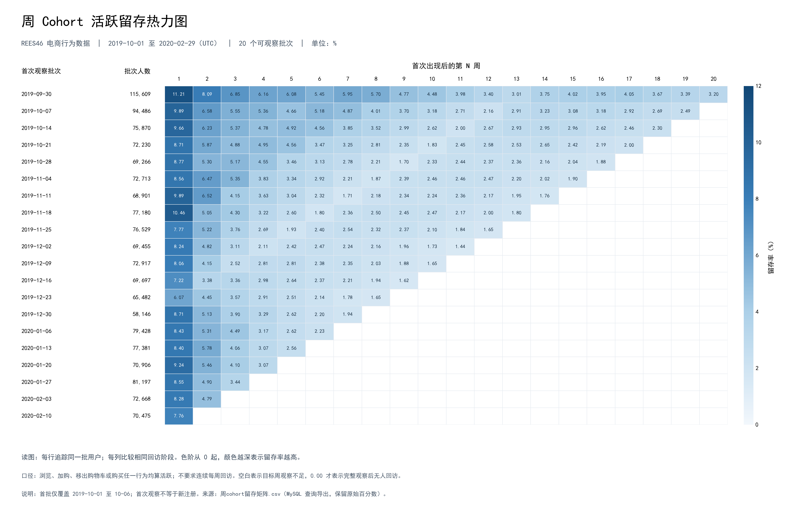

# 美妆电商用户运营分析

> 使用 **Python + SQL（MySQL 8.0）** 分析 **1,958 万条行为事件、164 万名观察用户**，建立严格转化漏斗、周 Cohort 留存和用户活跃分群，围绕流量结构、选品转化、早期留存与沉默客群唤醒，形成一家美妆网店的精细化运营策略。

[查看完整报告](report/report.md) · [下载 Word 报告](report/report.docx) · [浏览 SQL](sql/README.md) · [复现说明](docs/REPRODUCE.md)

导航：[业务问题](#核心经营议题) · [核心成果](#核心洞察与分析成果) · [分析流程](#分析流程) · [关键难点与处理](#关键难点与处理) · [技术实现与代码](#技术实现与代码) · [数据质量与验证](#数据质量与验证) · [业务建议](#精细化运营策略) · [如何复现](#如何复现) · [项目结构](#项目结构) · [来源与局限](#来源与局限)

## 核心经营议题

美妆网店运营既要关注用户是否来到网站，也要理解用户能否从浏览走向购买，以及首次访问后是否再次回来。本项目围绕三个相互关联的经营问题展开：

| 业务问题 | 分析方法 | 支持的决策 |
|---|---|---|
| 用户从浏览到加购、购买的表现如何？ | 同用户、同商品的严格时序漏斗与 7 天观察窗 | 确定商品筛选、比较及购买路径的排查方向 |
| 首次访问后的用户何时回访？ | 按首次观察周建立 Cohort，比较相同批次的后续留存 | 确定新访用户运营的重点观察阶段 |
| 周活跃下降来自哪些用户构成变化？回流用户有何特征？ | 首次观察、连续活跃、回流分群及人数变化拆解 | 区分获客与回访的排查方向，选择召回试验人群 |

本项目使用公开的美妆电商用户行为数据（数据提供方：REES46），数据来自一家中等规模的美妆网店。数据覆盖 **2019-10-01 至 2020-02-29（UTC）**，清洗后为 **19,583,742 条事件、1,639,358 名观察用户**。分析对象是浏览、加购、移出购物车和购买行为；首次观察用户不等同于注册新客。

## 核心洞察与分析成果

### 周 Cohort 活跃留存热力图



使用 SQL 将用户按首次出现的自然周分组，计算后续各周的活跃留存，再用 Python 绘制热力图。**每行追踪同一批用户，每列表示首次出现后的第 N 周**；颜色越深，留存率越高。

图中有 **20 个至少具备一周完整后续观察机会的批次**。为比较第 1、2 周的变化，进一步选取两周均可完整观察的 **同一组 19 个批次**，按精确人数汇总计算：

> **第 1 周留存 8.85% → 第 2 周留存 5.55%，下降 3.30 个百分点。**

这提示首访后两周值得优先开展用户运营验证。它反映相同初始用户群在不同周的回访情况，不是“第 1 周回来的人中又流失了多少”。

读图口径：四类行为任一发生即算活跃，不要求连续每周回访；空白表示目标周观察不足，0% 才表示完整观察后无人回访。首批仅覆盖 2019-10-01 至 10-06。整体留存按人数加权计算，不直接平均图中已舍入的百分比。

[查看原尺寸图片](figures/weekly_cohort_retention_heatmap.png) · [MySQL 留存矩阵](sql/周cohort留存矩阵.csv) · [精确人数结果](data/analysis_output/weekly_retention_validation_20261020/retention_detail_exact.csv)

### 其他主要发现

| 分析模块 | 关键结果 | 业务含义与解释范围 |
|---|---|---|
| 严格 7 天漏斗 | 浏览 **1,529,295** 人 → 加购 **268,258** 人 → 严格购买 **80,366** 人；浏览加购率 **17.54%**，加购后严格购买率 **29.96%** | 为商品选择与购买路径的进一步排查提供基准；同用户同商品路径，不是全站订单成交率 |
| 周活跃变化 | 2019-11-25 与 2019-12-30 起始周：**114,075 → 82,724** 人，下降 **27.48%**；首次观察人数减少贡献净降幅的 **58.64%** | 提示同时排查新访来源与回访表现；这是指定两周的算术拆解，不能证明下降原因 |
| 回流间隔 | 所选 14 周、缺席 1～5 周后回流的 **196,795 条用户周记录**中，缺席 1～2 周占 **64.87%** | 可用于选择短间隔召回的探索方向；不是全部沉默用户的回流概率或召回成功率 |

交付成果包括：漏斗、留存、活跃及购买分群的 SQL 与汇总结果，Python 清洗、核验及绘图代码，周留存热力图，以及含 10 幅图表的美妆电商用户运营分析报告。关键数字的文件依据见[结果索引](docs/REPRODUCE.md)。

## 分析流程

```text
五个月原始事件 CSV
  → Python：合并、完全重复记录去重、字段与 UTC 时间处理
  → MySQL：导入事件明细、建立查询索引、核对数据基准
  → SQL：严格漏斗 / 周 Cohort 留存 / 活跃与回流分群
  → Python：独立重算、结果对账、热力图与报告图表
  → 业务解释：确定排查方向与后续试验建议
```

分析过程中分别维护事件、用户—商品路径、用户周和首次观察批次等粒度，按业务问题选择分母。周活跃趋势采用 **20 个完整自然周（2019-10-07 至 2020-02-23）**；这一日历周范围与热力图中的 20 个首次观察批次含义不同。

## 关键难点与处理

| 难点 | 处理方式 | 避免的问题 |
|---|---|---|
| 用户可能浏览多个商品，行为先后顺序不同 | 按用户与商品关联事件，要求浏览 < 加购 < 购买，再汇总去重用户 | 把不同商品的行为拼成一次转化，或将先购买后加购计入严格路径 |
| 数据末尾的用户观察时间更短 | 7 天漏斗只保留首次浏览不晚于 2020-02-22 23:59:59 的路径，后续事件相对该起点判断 | 把尚未获得完整转化机会的路径计为失败 |
| 不同留存周有不同数量的可观察批次 | 先判断目标周是否完整，再统一比较批次；按回访人数与批次人数分别求和计算 | 将批次构成差异误读成留存变化，或简单平均百分比 |
| 缺少观察与真实零回访容易混淆 | 不可观察的矩阵单元格保留为空，完整观察但无人回访记为 0 | 人为压低末期批次留存 |
| 高频用户和重复跨周记录影响计数 | 周内按用户去重；通过上一次活跃周区分连续活跃与回流 | 将事件量当用户数，或把跨周人数合计当全期去重人数 |

这些处理决定了指标如何解释。例如，某用户浏览商品 A、加购商品 B，并不能构成商品 A 的严格加购路径；一个用户在两周分别回流，会贡献两条用户周记录。

## 技术实现与代码

| 能力 | 项目中的具体实现 | 代码入口 |
|---|---|---|
| Python / pandas 数据处理 | 五个月合并、全字段去重、UTC 时间转换、CSV 与 Parquet 输出 | [数据清洗](python/01_data_cleaning.py) |
| SQL 路径构建与聚合 | 多表关联、条件时间筛选、MIN 首次事件、去重人数与转化率 | [漏斗路径](sql/04_funnel_user_product.sql) · [漏斗指标](sql/05_funnel_metrics.sql) |
| SQL Cohort 分析 | 用户周去重、首次观察周识别、递归 CTE 生成观察周、合格批次筛选与左连接 | [周留存分析](sql/weekly/02.周留存分析.sql) |
| SQL 窗口函数与分群 | LAG 获取上一次活跃周，CASE WHEN 区分首次观察、连续活跃和回流 | [用户活跃度分析](sql/weekly/03.用户活跃度分析.sql) |
| Python 独立核验 | 从清洗事件重建漏斗和留存，核对人数、时间边界及聚合结果 | [漏斗核验](python/03_validate_funnel_results.py) · [留存核验](python/05_validate_weekly_retention.py) |
| Python / matplotlib 可视化 | 从 MySQL 导出矩阵绘图，保留观察不足的空白，标注批次人数和百分比 | [留存热力图](python/04_plot_weekly_retention_heatmap.py) |

完整查询顺序、表名与输入依赖见 [SQL 说明](sql/README.md)；业务定义见[事件字典](docs/event_dictionary.md)与[指标字典](docs/metric_dictionary.md)。

## 数据质量与验证

清洗按全字段完全重复记录去重，随后删除 brand、category_code 两列，转换事件时间和价格类型。分析以用户、商品、事件及时间为主，不把价格字段直接解释为真实支付金额。

零价和负价记录保留为行为事件：清洗结果中分别为 **86,326 条**和 **124 条**；缺失会话 ID 的 **4,085 条**记录也保留，核心漏斗按用户与商品识别路径。这样的处理使行为分析不会仅因价格或会话字段异常而直接丢失有效事件。

验证覆盖三个层面：

- **输入基准**：核对清洗行数、四类事件数量、价格及时间范围，见[导入基准结果](data/analysis_output/funnel_20260922/verification/import_baseline.csv)。
- **计算逻辑**：检查路径粒度、时序、完整观察窗及人数一致性，并使用合成边界样本验证 SQL 逻辑。
- **结果对账**：历史全量漏斗独立核验记录包含 **54 项检查**；留存核验记录包含 **355 项检查**，并有 MySQL 导出对账。对应[漏斗检查明细](data/analysis_output/funnel_20260922/verification/validation_checks.csv)与[留存检查明细](data/analysis_output/weekly_retention_validation_20261020/validation_checks.csv)可查阅。

完整验证范围、数据库执行证据及复现限制集中记录在[复现与核验说明](docs/REPRODUCE.md)。

## 精细化运营策略

围绕选品决策提效、首访客群培育、流量恢复期的购买承接及短期沉默客群唤醒，明确产品、商品与用户运营的协作方向。以局部试点验证增量价值，再结合毛利、触达成本与客户反馈安排推广。

| 依据 | 建议行动 | 后续如何验证 |
|---|---|---|
| 首访后第 1→2 周留存下降 | 优先设计首访后两周的回访引导与商品选择支持 | 设置对照组，观察增量回访、购买及负反馈 |
| 浏览到加购存在较大的未转化人群 | 完善网店商品规格、价格与可售信息；补充品类和渠道证据后排查筛选、比较及展示体验 | 对具体体验改动开展试验，同时观察购买表现 |
| 周活跃下降包含首次观察人数和连续活跃人数的减少 | 分别追踪新访来源与存量用户回访，避免只看总活跃 | 补充渠道、活动和产品变更记录验证原因假设 |
| 所选已回流记录集中于缺席 1～2 周 | 优先探索短间隔未活跃用户的低成本提醒方案 | 以随机对照评估额外购买，补充毛利、触达及补贴成本，跟踪退款和退订 |

上述内容是基于历史数据提出的试验建议，效果尚待验证。漏斗未转化人数不等于可挽回人数，观察到的回流也不能直接归因于运营触达。

## 如何复现

环境：**Python 3.13、MySQL 8.0**。先克隆仓库并安装依赖：

```powershell
git clone https://github.com/Jiang-Chenxiao-data/rees46-funnel-analysis.git
cd rees46-funnel-analysis
python -m pip install -r requirements.txt
```

不下载原始数据也可以运行边界逻辑检查：

```powershell
python python/check_funnel_sql_fixture.py
python python/03_validate_funnel_results.py --self-test
```

SQL 样本检查使用 SQLite 方言适配；它检验逻辑，不替代 MySQL 执行验收。

完整数据复现步骤：

1. 从下方来源取得 2019 年 10 月至 2020 年 2 月五个月 CSV，放入 `data/raw/`。
2. 执行 `python python/01_data_cleaning.py`，再执行 `python python/02_parquet_to_mysql.py`，生成清洗数据和 MySQL 导入文件。
3. 按 [SQL 执行顺序](sql/README.md)修改导入路径，在独立空数据库中建立明细与派生表；周分析另需按其表依赖执行。
4. 根据[完整复现说明](docs/REPRODUCE.md)运行漏斗及留存独立核验，核对输入版本和输出结果。

清洗脚本全量内存运行，需要足够内存；固定输入指纹、已有数据库表和各脚本输出覆盖行为，请按复现说明处理。

## 项目结构

```text
rees46-funnel-analysis/
├─ python/                 # 数据清洗、独立核验、热力图绘制
├─ sql/
│  ├─ 00–07 系列脚本       # 明细、导入、索引、漏斗与核验
│  ├─ weekly/              # 留存、活跃、回流及周购买分群
│  └─ archive/             # 历史 SQL 原文与旧版记录
├─ data/analysis_output/   # 已归档的汇总结果与检查明细
├─ figures/                # 周留存热力图及报告内嵌图表
├─ report/                 # 最终报告 Markdown 与 Word
├─ docs/                   # 指标定义、复现、验证及简历材料
├─ requirements.txt
└─ README.md
```

## 来源与局限

数据发布方：[REES46 datasets](https://rees46.com/en/datasets)；下载入口：[Kaggle Cosmetics Shop](https://www.kaggle.com/datasets/mkechinov/ecommerce-events-history-in-cosmetics-shop)。原始数据与用户级明细不随仓库分发，使用与再分发须遵守来源许可。

- 数据描述为一家美妆网店，具体店名与所在国家未在本项目中确认；数据提供方名称不代表网店归属。建议围绕该网店的用户运营展开。
- 首次观察受数据起点限制，不代表首次注册或真实首次访问；同商品严格路径也无法覆盖所有购买方式。
- 缺少成本、利润、营销触达和实验分组信息，当前结果支持描述与诊断，无法证明干预效果或计算真实运营 ROI。
- 已归档结果与独立核验的证据范围不同于整理版 SQL 在新环境完整运行；具体已验证与待补项见[复现说明](docs/REPRODUCE.md)。

最新版报告于 2026-11-07 同步，Word 与网页报告采用一致的业务表述；代码与统计结果保持原有版本。
