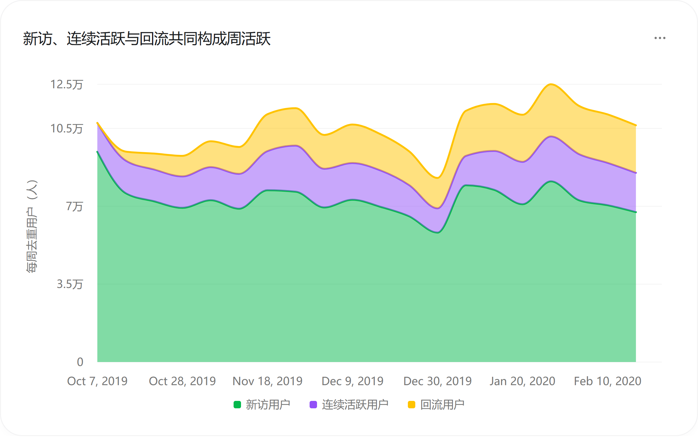
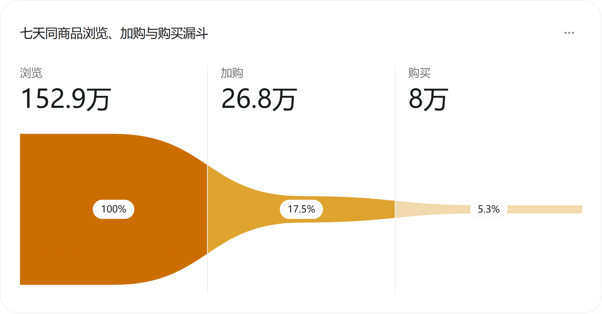
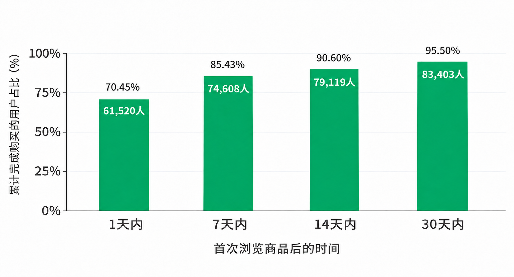
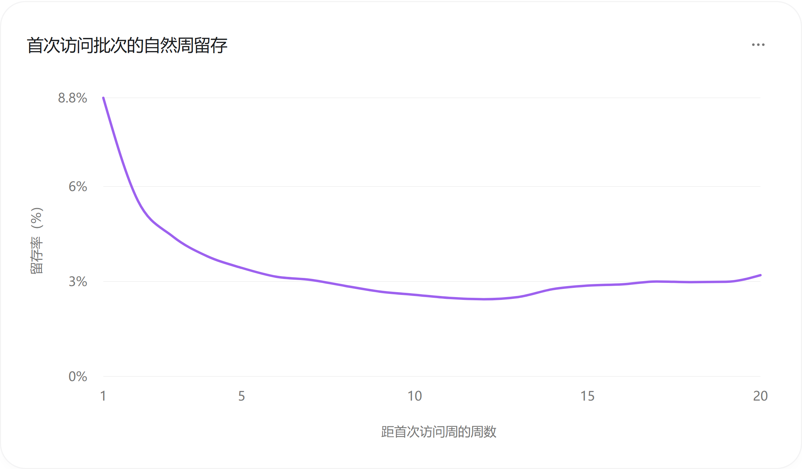
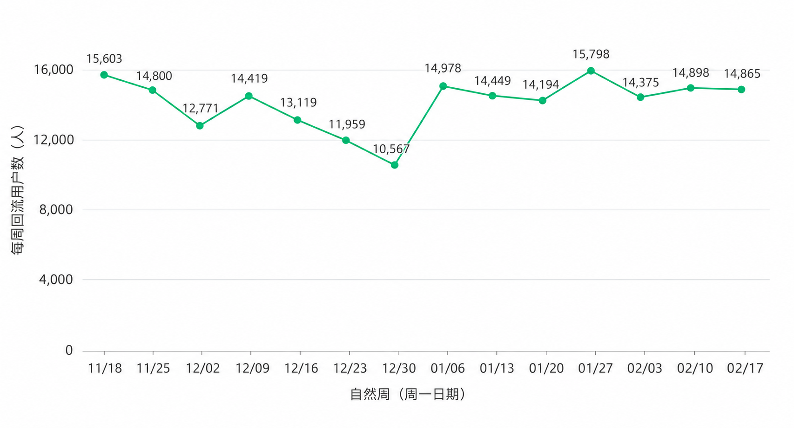
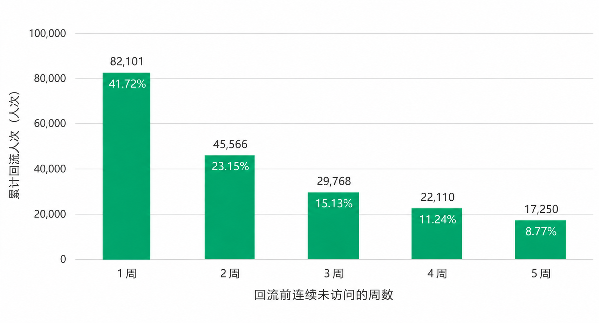

# 美妆电商用户运营分析

美妆垂直电商用户行为洞察与精细化运营研究（2019年10月—2020年2月）

## 一、执行摘要

本研究报告聚焦美妆电商平台的用户全生命周期运营提效。基于2019年10月至2020年2月期间累计1,639,358名访问用户的19,583,742条购物行为记录，报告围绕“流量结构演进、选品转化漏斗、生命周期留存与沉默唤醒”四大核心业务场景开展深度诊断。研究结果表明，当前平台增长的破局关键在于降低前端选品决策门槛，并强化新客首访后黄金两周的破冰转化与分层触达运营。

在选品决策与购物转化层面，用户从“商品浏览”向“加入购物车”跃迁的流失最为显著，亟需围绕核心美妆品类升级属性导购与商品横评能力。在7天同商品转化链路中，浏览至加购转化率为17.54%，而加购至最终购买转化率达29.96%，反映出用户一旦形成加购意向便具备较高的成交确定性。然而，同一类目下曝光规模相近的两款主力单品，其加购率分别仅为1.90%和8.01%，显著的同品效率分化为首期商品信息治理与导购改版明确了高优先级切入点。

在新客孵化与早期留存层面，运营重心应前置至新客首访后的前两周，重点扶持“首访未购”高潜人群完成破冰转化。平台周活跃客群中，新访用户占比高达63.16%～87.94%，呈现显著的“拉新驱动型”特征。追踪具备完整两周观察周期的同批新客可见，首访后第1周、第2周留存率分别为8.85%和5.55%；其中，首访当周未购用户的第2周留存率仅为5.22%，显著低于首访已购用户的12.57%。首单转化不仅直接贡献当期营收，更是构筑后续复访粘性的关键锚点。

在流量恢复与承接质量层面，营销投放需从单一的“流量规模考核”升级为“流量与转化双维协同”。2019年11月25日当周至12月30日当周，平台周度活跃规模阶段性回落27.48%，其中新客流入缩减与连续活跃老客流失合计解释了89.88%的降幅。尽管2020年1月6日当周活跃用户规模迅速回升至112,880人，但当周购买用户占比仍较11月25日基准周偏低1.78个百分点。这表明流量规模虽已修复，但投放引流与落地页选品承接之间仍存在匹配缺口。

在沉默客群召回与存量激活层面，连续沉默1～2周是存量用户自然回流与干预唤醒的黄金窗口期。在14个完整周的存量回流记录中，沉默1～5周后重返平台的用户人次里，间隔1～2周的短期沉默客群占比高达64.87%。建议依托既有用户行为分层体系，优先针对沉默1～2周的高意向人群开展轻量化触达试点，同步配置专属“继续选购”承接页，并以增量毛利与运营投入产出比（ROI）作为扩量决策依据。

在组织协同与落地路径上，建议采取“小步快跑、对照验证”的闭环推进机制：由经营管理层统筹试点品类、目标客群与预算边界；商品运营团队推进重点单品信息标准化；产品与技术团队迭代属性筛选与购物车承接链路；用户运营团队执行分层触达策略；商业分析团队围绕增量转化、回访留存、获客成本及用户负反馈开展全周期评估。具体业务策略与落地路径详见第六章。

## 二、研究背景与核心议题

在美妆电商存量竞争日益激烈的行业背景下，平台的精细化增长依赖于“前端公域获客、中端选品转化、后端存量复访”三大经营环扣的高效咬合。流量增长能否有效沉淀为实付购买、高频商品浏览能否顺畅转化为加购意向、新晋访客能否跨过首访流失拐点成长为高粘性复购客户，直接决定了平台营销预算配置与产品运营迭代的优先序。

审视本报告研究周期内的业务表现，平台既经历了季节性流量低谷与快速反弹的周期波动，也暴露出同品类单品加购效率悬殊、未购新客早期快速流失等典型结构性痛点。本研究致力于穿透表层流量数据，将客群结构波动、选品漏斗折损与生命周期留存表现进行交叉归因，协助业务团队精准锚定高回报运营抓手，构建可量化、可复制的业绩增长闭环。

## 三、研究目标与分析框架

### 3.1 核心研究目标

本研究紧密围绕美妆电商日常经营的三大核心业务关切展开：第一，流量底盘诊断——平台周度活跃流量的周期性波动主要由哪类客群（新访客群、连续活跃客群或沉默回流客群）驱动？第二，转化漏斗寻优——在用户从浏览种草到下单购买的决策链路中，哪一环节造成了最大规模的潜在购买力折损？第三，生命周期提效——新客首访后的早期留存衰减规律如何，首访破冰购买对后续用户粘性产生何种幅度的分化影响？

基于上述诊断结论，报告进一步确立了四大业务攻坚方向：重点品类导购与比选体验升级、首访黄金两周未购新客培育、引流恢复期的货盘承接优化，以及短期沉默客群的精准唤醒。每一项策略举措均明确了协同职能、试点范围及商业评估标尺，确保研究结论具备高度的业务可执行性。

### 3.2 诊断方法与业务逻辑框架

在研究方法论上，本报告构建了“流量结构拆解—单品决策漏斗—客群留存追踪”三维诊断模型：其一，流量层面按自然周将全站活跃用户解构为新访、连续活跃与沉默回流三大互斥客群，识别大盘波动的核心贡献因子；其二，转化层面建立7天同商品标准购买漏斗，并结合成交用户的实际决策耗时分布，刻画美妆消费者的选品犹豫期与黄金转化窗口；其三，留存层面采用同期群追踪方法，锁定具备同等观察窗口的首访客群，量化评估首访后前两周的留存拐点及首单转化的粘性增益。

在策略推导上，报告将“流量下滑贡献度拆解”、“主力单品加购率对标”与“沉默回流周期分布”转化为运营排期的优先级标尺。所有运营干预方案均遵循“局部试点、对照验证、ROI导向扩量”的商业准则，优先在高流量品类与高意向客群中验证增量价值，再行全站推广。详细数据口径与图表索引见第四章及附录。

## 四、数据概况与核心业务口径

### 4.1 样本周期与业务行为覆盖

本研究基于REES46公开发布的垂直美妆电商真实交易与行为数据集，完整记录了一家中型美妆线上零售商城的用户全链路交互轨迹。样本时间跨度为2019年10月1日至2020年2月29日，经规范化数据治理后，共涵盖1,639,358名独立用户的19,583,742条有效业务交互记录。其中，大盘周度趋势分析覆盖2019年10月7日至2020年2月23日的20个完整自然周；沉默用户回流周期分析覆盖2019年11月18日至2020年2月23日的14个完整自然周。

业务数据完整还原了消费者在站内的核心购物动作，涵盖“商品浏览（种草关注）”、“加入购物车（产生意向）”、“移出购物车（意向比选/放弃）”以及“下单购买（交易达成）”四大关键节点，并配套记录了行为发生时间、商品归属类目及商品标价信息。需注意的是，行为记录中的商品标价反映前台展示价格，在未叠加优惠券、满减补贴及退换货扣减前，不等同于财务口径的净实收金额。

在经营归因应用上，现有行为数据能够精准刻画站内各环节的用户流转效率。若需进一步追溯站外引流渠道质量、库存缺货影响、物流履约体验或促销让利幅度，则在后续实际业务落地中需打通投放渠道台账、商品进销存（ERP）及营销活动记录；针对搜索导购改版与消息触达试点，亦需配套接入页面曝光与实验分组记录。

### 4.2 用户分层体系与核心指标界定

新访用户（拉新客群）：在统计观察期内首次在站内产生有效交互行为的用户，用于衡量平台前端流量获取与拉新规模。

连续活跃用户（高频高粘客群）：上一自然周与本自然周均在站内产生有效交互行为的用户，反映平台核心活跃基本盘的稳定度。

周活跃次周留存率：上一自然周活跃用户中，在本自然周继续保持活跃的转化比例，用于监测存量活跃大盘的周度粘性波动。

回访用户：完成首次访问后，在后续统计周期内再次到访产生交互的用户总称（涵盖连续活跃用户与沉默回流用户两大群体）。

回流用户（自然唤醒客群）：此前至少间隔一个完整自然周未到访、而在本自然周重新回到平台产生交互的用户，反映存量沉默客群的自然回访活力。

待召回用户（沉默目标客群）：依据业务预设的未访问时间阈值圈定的存量唤醒候选人群，作为精准营销触达的目标池。

用户召回（存量激活干预）：面向待召回沉默客群定向推送料品推荐、购物车提醒或权益激励的运营动作，其真实业务增量需通过随机对照实验（A/B测试）予以核验。

新客批次留存率（同期群留存）：按用户首次访问所在自然周划定同期群批次，统计该批次用户在首访后第N个自然周再次到访活跃的比例，用于评估新客中长期生命周期价值。

购买转化率：在指定业务链路与决策时间窗内，完成下单购买动作的用户占比，用于衡量站内选品导购与交易闭环效率。

在转化链路核算上，主漏斗聚焦“同一用户针对同一款商品，在首次浏览后7天内依次完成浏览、加购与下单”的标准单品决策路径，以精准评估单品导购说服力；同时单列无时间窗口限制的87,330名标准路径成交用户，专项测算美妆消费者的真实下单决策耗时。所有周度与留存指标均严格限定在具备完整观察周期的客群批次内核算，确保跨期对比的公平性与严谨性。

### 4.3 业务评估范围与经营应用前提

本报告所呈现的流量结构演进、单品转化漏斗、留存矩阵及回流周期分布，均已经过全量行为明细的多维交叉核验，并深入结合了首访周购买状态交叉留存、高流量同品类单品加购对比等业务专题诊断，为下一阶段的精细化运营试点提供了扎实的数据基座。

在阅读与应用本报告指标时，业务团队需把握三项基本原则：一是区分“全周期累计转化”与“单周截面转化”的统计维度，避免跨口径简单加减；二是认识到现在“同商品7天标准漏斗”主要评估单品种草至成交的闭环效率，而跨品类凑单、直购等多元购物场景则通过补充路径予以辅助观测；三是所有留存与转化对比均建立在同等观察周期基准之上，消除近期新客观察期不足带来的统计偏差。

研究样本源自一家中等规模垂直美妆网店的真实运营沉淀。报告中针对流量波动的结构拆解旨在定位核心受影响客群，而针对导购筛选优化、新客培育及沉默唤醒的具体运营方案，在实际排期上线时均建议采用小流量A/B对照试验验证净增量贡献。各图表的详细统计口径见附录。

## 五、用户行为深度诊断与业务洞察

本章沿着美妆电商“流量获取—选品转化—留存复访”的业务主线，依次诊断三大核心问题：全站活跃流量大盘由何种客群驱动、消费者在选品决策哪一环节流失最为严重、以及新客首访后的留存拐点出现在何时。三大维度的诊断结论将直接映射至后续的流量承接优化、导购体验升级与生命周期分层运营策略。

### 5.1 流量大盘演进与访问结构洞察

纵观20个完整自然周的演进轨迹，平台周度活跃规模呈现出“年末季节性回落、年初快速反弹并创出新高”的V型复苏态势，且新访客群始终是支撑平台活跃大盘的第一主力。本节通过拆解新访、连续活跃与回流三类客群的动态演进，揭示流量波动的内在结构机理。

#### 5.1.1 流量大盘周期性波动与大促前置效应

平台周度活跃规模在年末跨年周触及阶段性波谷后展现出强劲的修复韧性。具体而言，周活跃用户数由11月25日当周的114,075人回落至12月30日当周的82,724人；跨入新年后，1月6日当周迅速反弹至112,880人，并于1月27日当周攀升至124,830人的观测期峰值。值得业务高度关注的是，在大促节点表现上，11月18日当周（黑五前一周）的购买用户数达10,494人，反而高出黑色星期五当周（8,622人），体现出鲜明的“大促蓄水与前置爆发”特征，提示大促运营复盘与货盘备货周期必须向前延伸。

图1  来源：完整自然周的用户规模与构成。范围：2019-10-07 至 2020-02-23，20 个完整周。

#### 5.1.2 活跃流量结构特征与新老客驱动力拆解

从客群结构看，平台属于典型的“拉新驱动型”电商，每周新访用户占周活跃总规模的63.16%～87.94%；新访、连续活跃与回流三类客群彼此互斥、共同构筑了全站流量基本盘（注：观测期首月的新访识别受历史追溯起点影响，自11月中旬起结构趋于稳态）。较高的新客占比一方面印证了前端获客渠道的持续输血能力，另一方面也暴露出存量老客沉淀不足的短板。

在日常经营监控中，建议运营周报摒弃单一的“总活跃人数”或“新客占比”视角，常态化并行追踪新访、连续活跃与回流三类客群的绝对规模及对应购买转化率。唯有将“前端拉新扩量”与“存量老客留存”解耦监测，方能避免因新客脉冲式涌入掩盖老客粘性下滑的经营隐患，实现获客投放预算与存量运营资源的科学配比。

图2  来源：完整自然周的用户规模与构成。范围：2019-10-07 至 2020-02-23，20 个完整周。

### 5.2 选品决策转化漏斗与成单时效分析

在站内购物转化链路上，“商品浏览至加入购物车”是用户折损体量最大的核心瓶颈，表明大量美妆消费者在选品比对阶段因决策信息不足而中断购物。本节结合7天同商品标准转化漏斗与成交决策耗时分布，明确前端商品导购改造与黄金时间窗触达的业务抓手。

#### 5.2.1 核心购物路径转化表现与关键流失症结

为精准评估单品从种草关注到下单成交的转化效率，研究构建了“7天同商品标准购买漏斗”，即追踪同一用户在首次浏览某款美妆商品后的7天完整周期内，针对该商品依次完成浏览、加入购物车与下单购买的流转表现（按独立用户去重统计）。

| 漏斗阶段 | 去重用户数 | 相邻转化率 |
| --- | --- | --- |
| 浏览 | 1,529,295 | — |
| 加购 | 268,258 | 17.54% |
| 购买 | 80,366 | 29.96% |

图3  来源：7 天同商品购买漏斗。范围：2019-10-01 至 2020-02-29。

漏斗诊断数据清晰揭示出“前端种草易、加购决策难”的业务痛点：在1,529,295名商品浏览用户中，共有268,258人进入加购环节（浏览至加购转化率仅为17.54%），最终80,366人完成同品购买（加购至购买转化率达29.96%，浏览至购买整体转化率为5.26%）。两段链路分别流失了1,261,037名和187,892名潜在消费者，其中浏览至加购环节的流失规模高达加购至购买环节的6.7倍。由此可见，优先针对高曝光、低加购的核心美妆品类优化属性筛选、功效标签与多品比选功能，是撬动全站交易增长最具杠杆效应的突破口。

此外，若纳入浏览后跳过购物车直接下单的快捷购买人群，7天内浏览转购买的覆盖规模为88,980人，整体转化率为5.82%（含标准漏斗中的80,366名用户）。两套口径相互印证，共同表明购物车是绝大部分美妆消费者完成比选决策的必经枢纽。

#### 5.2.2 用户购买决策周期与黄金转化窗口期

针对87,330名完成同商品“浏览—加购—购买”标准链路的用户，进一步测算其首单成交路径的决策耗时可见：美妆用户的购买决策呈现出鲜明的“短平快爆发、长尾渐进收口”特征。用户从首次浏览目标商品到最终下单的中位耗时仅为1.21小时；高达70.45%的成交用户在首次浏览后24小时内即拍板下单，85.43%在7天内完成购买，14天与30天内的累计成交占比则分别达到90.60%和95.50%。

这一成单时效规律对业务运营具有双重指导意义：一方面，超七成订单在首日内达成，要求商品详情页必须在用户首访的第一时间直观呈现核心规格、促销到手价、肤质/色号适配度及物流履约时效，最大限度消除当场决策阻力；另一方面，针对加购后未在24小时黄金窗口内下单的犹豫客群，用户运营团队可在首访后第1～7天内分层设置阶梯式购物车提醒，并通过小流量对照实验验证最佳触达时机，切实在第7天长尾窗口关闭前挽回高意向订单。

图4  来源：已转化用户的首次完成路径耗时。范围：2019-10-01 至 2020-02-29。

### 5.3 用户生命周期留存特征与粘性诊断

新客获取后的早期留存衰减是制约平台存量资产沉淀的核心症结，尤其是首访后前两周的回访率落差显著。用户运营需紧紧抓住首访后两周的“黄金培育期”，通过构建便捷的“最近浏览”与“购物车续购”承接入口，降低新客二次回访的选品搜寻成本。

本节通过同期群生命周期追踪方法，依次剖析新客首访后的整体留存衰减斜率、固定客群在首访后第1周与第2周的粘性落差，以及跨周期不同批次新客的中长期留存表现，为制定分阶段用户培育策略提供量化依据。

#### 5.3.1 新客首访后早期留存衰减规律

全样本同期群追踪显示，新客在首次到访后的第1周、第2周和第4周留存率分别为8.80%、5.55%和3.80%（用户在目标自然周内产生浏览、加购、移除或购买任一交互即计为留存活跃）。留存曲线呈现典型的“首周断崖式过滤、次周二次滑坡、四周后趋于平缓”的L型形态，表明新客首访后的前两周是决定其能否转化为平台常客的分水岭。

图5  来源：自然周同期群用户留存。范围：数据截至 2020-02-29。

#### 5.3.2 首访黄金两周留存表现与培育窗口定位

为剔除不同批次观察时长差异的影响，锁定具备完整两周观察期的19个首访周批次（合计1,440,061名新访用户）进行同口径对标：该批新客在首访后第1周的留存率为8.85%（127,445人回访），至第2周即回落至5.55%（79,939人回访），短短一周内留存率净流失3.30个百分点，降幅超过三分之一。

这一显著的早期粘性折损印证了将“首访后两周”确立为核心运营干预窗口的必要性。进一步结合首访当周是否达成购买进行交叉诊断可见，首单转化状态对后续留存具有决定性的分层效应（相关细分数据与定向培育策略详见第6.2节）。

图6  来源：同一批次集合的早期留存比较。范围：固定 19 个可观察批次。

#### 5.3.3 跨周期客群留存矩阵与长尾留存表现

在中长期留存评估中，越往后的留存周次越聚焦于早期入站客群的沉淀表现（例如第20周留存率3.20%完整反映了首周入站的115,609名种子客群的长尾粘性）。因此，业务团队在开展跨期留存复盘时，应严格遵循“同批次纵向追踪、同周次横向对标”的评估准则。

图7以同期群留存热力矩阵的形式，完整呈现了20个首访周批次在后续各周的留存轨迹。纵向审视同一列，可直观对比不同营销周期引入新客的早期留存质量，快速识别高质量获客周期与异常流失波段；横向审视同一行，则可清晰把握单一客群批次从首访破冰到长尾沉淀的生命力演变（矩阵右下方空白区域代表尚未到达对应观察周期的近期批次）。

图7  来源：自然周同期群用户留存。范围：数据截至 2020-02-29。

## 六、核心结论与精细化运营策略建议

综合全链路行为诊断结论，该美妆电商平台下一阶段的运营提效必须紧密围绕“缩短选品决策路径”与“深耕首访黄金两周及短期沉默窗口”双核展开。建议由经营负责人统筹跨部门协同：产品与技术团队聚焦搜索筛选与续购承接体验升级，商品运营团队夯实重点单品信息标准化，用户运营团队落地新客培育与沉默唤醒的精准触达试验。以下从四大核心业务场景逐一阐述数据锚点、落地策略与商业评估标准。

### 6.1 选品决策提效：优化导购筛选机制与商品信息标准化

【核心痛点与数据依据】“商品浏览至加入购物车”是全站漏斗折损最严重的环节，高达82.46%的浏览用户未能跨入加购阶段（7天同品浏览至加购转化率仅为17.54%）。深入对标全站浏览量排名前六的头部单品可见，即便处于同一美妆类目、具备相近的流量曝光规模，两款主力商品的加购转化率却分别仅为1.90%和8.01%，存在6.11个百分点的显著效能鸿沟。这一结构性差异为商品治理与导购优化提供了精准的靶向切入点。

【产品与导购优化策略】针对美妆消费强功效、重适配的选品特性，产品与商品团队应联合重构重点类目的结构化导购体系：一是完善按细分品类、核心功效、适用肤质、色号规格及价格带的多维组合筛选器与同品横评工具；二是在列表页与商详页首屏标准化透出“核心规格、折后到手价、发货时效与退换保障”，降低信息搜寻成本。针对高流量品类页的改版与排序策略调整，应采用同入口随机分流（A/B测试）机制，以入组用户7天整体购买转化率作为核心验收指标，避免仅凭历史静态加购率盲目压降潜品曝光。

【商品信息治理机制】商品运营团队应建立“高曝光、低加购”异常单品的常态化巡检清单，优先核查并补齐商品标题卖点、肤质色号参数、高清实拍视觉、价格力展现、库存可售状态及售后承诺等关键决策要素。在确保同类目商品信息展示规范统一的基础上，持续追踪商详页信息完备度提升对加购率及最终成交率的净正向拉动。

### 6.2 新客破冰转化：聚焦首访黄金两周的高潜未购人群培育

【核心痛点与数据依据】平台每周高达63.16%～87.94%的活跃流量来自新访客群，但新客在首访后前两周面临严峻的流失考验。在具备完整两周观察期的1,440,061名新访用户中，第1周留存率为8.85%，第2周进一步滑落至5.55%，两周之间快速流失3.30个百分点。

【客群分层洞察】以首访当周是否完成破冰购买进行交叉切分，新客群体的后续粘性呈现出量级分化：首访当周未购新客规模高达137.58万人（占新客总量的95.54%），其首访后第1周、第2周回访率分别仅为8.46%和5.22%；而首访当周已购新客虽仅6.42万人，但其第1周、第2周回访率分别高达17.30%和12.57%，是未购新客的2倍以上。因此，激活庞大“首访未购客群”的二次回访与首单破冰，是提升平台整体留存水位与GMV增量的最大金矿。

【分层培育与试点方案】建议对新访客群实施差异化双轨运营：第一，针对“首访已加购但未下单”且具备触达通道的高潜新客，由用户运营在首访后第1周黄金窗口内定向推送购物车余量/价格提醒，同步在首页及消息落地页配置“最近浏览”与“一键续购”快捷入口，并辅以同品类热销替代款推荐，通过随机对照实验评估14天累计回访率与首单转化率；第二，针对“首访已购”新客，则将运营重心转向实时物流追踪、美妆使用指南与售后无忧保障，夯实首单履约体验以培育长期复购。

### 6.3 流量质量升级：推进精准品类引流与老客回访承接协同

【核心痛点与数据依据】复盘2019年11月25日当周至12月30日当周的流量波谷，全站周活跃用户由114,075人跌至82,724人，累计缩减31,351人（降幅达27.48%）。面对阶段性流量回落与复苏期的转化落差，前端推广运营与站内老客运营需建立紧密的联动机制。

| 用户类型 | 11月25日当周 | 12月30日当周 | 减少人数 | 降幅贡献 |
| --- | --- | --- | --- | --- |
| 新访用户 | 76,529 | 58,146 | 18,383 | 58.64% |
| 连续活跃用户 | 20,722 | 10,928 | 9,794 | 31.24% |
| 回流用户 | 16,824 | 13,650 | 3,174 | 10.12% |
| 合计 | 114,075 | 82,724 | 31,351 | 100.00% |

【流量下滑归因拆解】如表2与图8所示，在31,351人的周活跃减量中，新访用户减少18,383人（贡献58.64%的降幅），连续活跃老客减少9,794人（贡献31.24%的降幅），沉默回流用户减少3,174人（贡献10.12%的降幅）。新客流入缩减与高频老客流失合计解释了89.88%的大盘跌幅，明确了“外拓精准新流、内固高频老客”的双线修复方向。

图8  周活跃用户减少人数及降幅贡献。范围：2019-11-25当周与2019-12-30当周；柱顶为减少人数，柱内为占总降幅的比例。来源：周活跃用户分类统计。

【存量老客粘性修复】深入剖析连续活跃老客减少的9,794人可见，同期上周活跃基数由111,360人降至94,689人，而老客次周留存率更是从18.61%大幅滑落至11.54%。经因素拆解，约7,281人的减量源于老客次周留存率下滑（占比74.3%），仅约2,513人源于上期活跃基数缩水。这表明存量老客的粘性衰减是内生性痛点，运营团队需在首页显著位置强化“常购清单”、“浏览足迹”与“购物车动态提醒”，降低老客高频回访的操作摩擦。

【复苏期引流承接协同】在流量反弹阶段，2020年1月6日当周活跃用户虽已迅速恢复至112,880人（接近11月25日当周的114,075人），但当周购买用户数仅为6,523人，明显低于11月25日当周的8,622人，周活跃购买转化率由7.56%回落至5.78%（下滑1.78个百分点）。这种“流量恢复而成交滞后”的现象警示我们，推广团队在扩充外部流量时不能仅考核点击到站规模，必须与站内商品团队协同实现“千人千面所见即所得”——确保投放素材主推单品与落地页首屏商品高度一致，并清晰透出折后到手价、现货库存及配送承诺，实现引流规模与成交质量的同步修复。

### 6.4 沉默客群唤醒：把握1～2周短周期窗口开展分层精准触达

【核心痛点与策略方向】针对存量沉默客群的激活召回，应摒弃无差别的广撒网式推送，优先锁定“连续1～2周未访问”的短期沉默客群开展购物车与浏览足迹唤醒试点。在每期召回活动执行前，需基于触达当日的最新行为状态实时更新用户的浏览、加购与已购标签，确保目标用户名单与个性化承接内容的精准匹配。

【沉默回流周期规律】追踪2019年11月18日至2020年2月23日共14个完整自然周的存量回流表现：在连续沉默1～5个自然周后重返平台的用户中，每周自然回流规模稳定在10,567～15,798人之间，14周累计达196,795人次。按沉默间隔拆解可见，沉默1～2周即重返的用户高达127,667人次，占全部1～5周回流总人次的64.87%（其中间隔1周占41.72%，间隔2周占23.15%）。这一高度集中的短周期回流特征表明，用户沉默后的第1～2周是品牌记忆尚未消退、购物需求仍具延续性的黄金唤醒窗口。

【科学实验与增量评估】由于短期沉默客群本身存在一定比例的自然回流，为准确剥离自然回访与运营触达的真实净增量，试点必须采用严格的随机对照实验（A/B测试）：按用户沉默前的历史高意向行为（如已加购未购、高频浏览未加购、历史已购）先行分层，在各子层内随机划定“触达实验组”与“静默对照组”，在统一观察起点下并行追踪7天回访率、7天购买转化率及14天累计净增GMV。

图9  连续1～5周未访问后回流的每周用户数。范围：2019-11-18至2020-02-23，14个完整自然周；每周按用户去重。来源：回流间隔统计。

图10  不同未访问间隔的累计回流人次及占比。范围同图9；柱顶为累计人次，柱内为占196,795人次的比例。来源：回流间隔统计。

【个性化承接链路设计】在召回落地页承接上，产品与用户运营团队需实现“分群定制、千人千面”：针对沉默前存在加购或深度浏览行为的潜客，点击召回链接后直达保留其历史选品记录的专属续购页，并智能推荐同功效高转化美妆单品；针对历史已购老客，则优先导流至周期性复购补货专区、积分权益中心或订单服务页面，匹配差异化的触达话术与发送频次。

【商业ROI核算与扩量准则】在存量召回的商业化扩量决策中，经营负责人需建立以“净增量毛利”为核心的财务核算机制。由于行为日志中的商品标价不等同于实际毛利，评估时需完整纳入商品销售毛利、优惠券补贴成本、消息通道触达费用以及退货退款率、用户退订投诉率等负向指标。若实验显示召回仅拉动访问而未产生净增购买，则需回溯排查落地页选品匹配度与价格竞争力；唯有当“增量毛利全面覆盖营销与触达成本”且用户负反馈率处于安全阈值内时，方可将召回策略固化为常态化自动化运营流程。

## 附录  图表数据来源与统计口径备查

图1与图2  用户访问趋势与结构

数据来源：clean_data.parquet、weekly_user_composition.csv。

统计范围：2019-10-07至2020-02-23，共20个完整自然周（按UTC周一至周日划分）。用户在当周产生浏览、加购、移出购物车或购买任一有效行为即计为当周活跃，按独立用户每周去重统计。

分类规则：新访用户为观察期内首次出现有效行为的用户；连续活跃用户为本周与上周均保持活跃的用户；回流用户为此前至少间隔一个完整自然周未活跃、本周重新活跃的用户。三类客群彼此互斥，合计构成当周活跃用户总量。

图3  七天同商品浏览、加购与购买漏斗

数据来源：metric_dictionary.md、funnel_counts.csv、funnel_rates.csv。

路径规则：以同一用户对同一商品在观察期内的首次浏览为起点，在首次浏览起7天内严格依次发生加购与购买；仅纳入具备完整7天观察窗口的商品路径，完成商品路径判定后再按独立用户去重汇总。

指标核对：浏览用户1,529,295人，加购用户268,258人，购买用户80,366人；浏览至加购转化率17.54%，加购至购买转化率29.96%，浏览至购买整体转化率5.26%。正文补充的快捷路径允许浏览后跳过加购直接完成购买，覆盖88,980人，整体转化率5.82%（含标准漏斗购买用户80,366人）。

图4  首次浏览至购买的累计完成比例

数据来源：first_strict_duration.csv、first_strict_coverage.csv、metric_dictionary.md。

统计范围：在全观察期内完成同商品“浏览—加购—购买”标准路径的87,330名成交用户（不设7天时间窗上限），按每位用户最早完成购买的一条商品路径，测算从首次浏览该商品至完成购买的决策耗时。中位决策耗时为4,338秒（约1.21小时）。

累计分布：在首次浏览后1、7、14、30天内累计完成购买的用户数分别为61,520人、74,608人、79,119人、83,403人，分别占87,330名成交用户的70.45%、85.43%、90.60%、95.50%（分母为全周期完成标准路径的成交用户总数）。

图5与图7  首访后留存曲线与分组热力图

数据来源：overall_exact.csv、retention_detail_exact.csv、核对说明.md。

统计规则：按用户在观察期内首次出现有效行为的自然周划定同期群批次（首访周记为第0周），此后第N个自然周再次产生任一有效交互即计入第N周留存，分母为该首访批次的初始用户规模。各目标周仅纳入具备完整观察窗口的首访批次。

加权汇总：图5为各目标周具备完整观察机会的首访批次合并留存率（按各批次初始用户规模加权计算）。第1、2、4周分别纳入20、19、17个首访批次，加权留存率分别为8.80%、5.55%、3.80%；第20周仅最早一批次（115,609人）具备完整观察窗口，回访3,702人，留存率为3.20%。

热力矩阵：图7展示2019-09-30至2020-02-10起始的20个首访周批次在各目标周的留存率（单位：%），右下方空白区域表示尚未到达对应观察周期的批次。首批次归入2019-09-30所在自然周，实际行为记录自2019-10-01起算。

图6及第6.2节  同一组首访用户的两周回访与购买状态

数据来源：retention_detail_exact.csv、interpretation_calculations.json；首访周购买状态与后续留存交叉结果基于clean_data.parquet核算。

固定批次范围：锁定首次访问周为2019-09-30至2020-02-03的19个首访批次（合计1,440,061人），均具备首访后第1周与第2周的完整观察窗口。第1周、第2周回访人数分别为127,445人和79,939人，对应留存率为8.85%和5.55%，差值为3.30个百分点。

首访购买状态分层：按首访当周结束时是否产生购买行为划分，首访周未购用户共1,375,845人（正文简记为137.58万人），第1、2周回访率分别为8.46%和5.22%；首访周已购用户共64,216人（正文简记为6.42万人），第1、2周回访率分别为17.30%和12.57%。

图8及第6.3节  周活跃减少构成与购买恢复

数据来源：decline_decomposition.csv、weekly_user_composition.csv；周度购买用户核对采用weekly_purchase_verified_complete_weeks.csv。

波谷拆解范围：对比2019-11-25当周与2019-12-30当周，周活跃用户由114,075人降至82,724人，合计减少31,351人（降幅27.48%）。其中新访、连续活跃、回流用户分别减少18,383人、9,794人、3,174人，降幅贡献度分别为58.64%、31.24%、10.12%。

连续活跃变动拆解：两个对比周对应的上周活跃基数分别为111,360人和94,689人，次周留存率分别为18.61%和11.54%。采用两期均值权重进行因素拆解，次周留存率下滑对应约7,281人的减量，上周活跃基数缩水对应约2,513人的减量，合计减少9,794人。

复苏期购买对比：周购买用户指当周产生购买行为的去重用户数，购买用户占比以当周活跃用户总数为分母。2019-11-25当周购买用户8,622人（占周活跃的7.56%）；2020-01-06当周活跃用户恢复至112,880人，但购买用户为6,523人（占周活跃的5.78%），较基准周低1.78个百分点。

图9与图10及第6.4节  用户回流规模与未访问间隔

数据来源：return_gap_1to5_recomputed.csv、story_evidence.json。

统计范围：2019-11-18至2020-02-23，共14个完整自然周。统计当周重返活跃的用户距上一次活跃周之间连续未访问的完整自然周数（纳入间隔1～5周记录）。图9按周去重展示回流用户规模，每周介于10,567～15,798人之间。

间隔分布汇总：图10汇总14周累计回流人次，间隔1、2、3、4、5周的回流规模分别为82,101、45,566、29,768、22,110、17,250人次，合计196,795人次；对应占比分别为41.72%、23.15%、15.13%、11.24%、8.77%。其中间隔1～2周合计127,667人次，占64.87%。

统计口径说明：图10跨周累计采用人次口径（同一用户在不同周次满足回流条件时分别计入），各项占比均以1～5周回流总人次（196,795人次）为分母。

第6.1节补充比较与资料定位

重点单品对标：按全观察期商品浏览事件量筛选前六款头部单品，在完整7天观察窗口下分别核算各单品的独立浏览用户数、加购率与购买率。其中处于同一美妆类目、浏览用户规模相近的两款主力商品，其7天加购率分别为1.90%和8.01%（相差6.11个百分点），作为首期商品信息核查与导购改版的靶向依据。

项目资料归档路径：基础清洗数据位于data/processed/clean_data；漏斗分析结果位于data/analysis_output/funnel_20260922/verification；留存分析结果位于data/analysis_output/weekly_retention_validation_20261020；周购买核对结果位于data/analysis_output/status_archive_20261026/purchase。weekly_user_composition.csv、decline_decomposition.csv、return_gap_1to5_recomputed.csv及story_evidence.json归档于业务故事复核资料目录，并于report_evidence目录保留同版副本备查。

数据发布来源与网店应用说明

REES46数据目录：Cosmetics（2019年10月至2020年2月），https://rees46.com/en/datasets

数据源说明：公开数据集采集自一家中等规模美妆垂直电商网店（由REES46平台提供脱敏数据），发布页地址：https://www.kaggle.com/datasets/mkechinov/ecommerce-events-history-in-cosmetics-shop。本报告提出的运营优化策略聚焦于该网店的站内导购体验、新客转化培育及存量用户召回；后续开展线上A/B试点时，建议配套补充页面曝光、消息触达、营销成本及实验分组日志。

研究方法论参考：贝恩公司与凯度消费者指数（Worldpanel）联合发布的《渠道破局：中国快消品市场的机会和挑战》（第4页），以及普华永道《2025年消费者之声全球调研——中国报告》（第10～12页），用于指导美妆零售指标体系拆解与商业运营场景建模。报告正文所引用的全部用户规模、转化比率及趋势变动数据均严格源自本项目实证分析结果。
