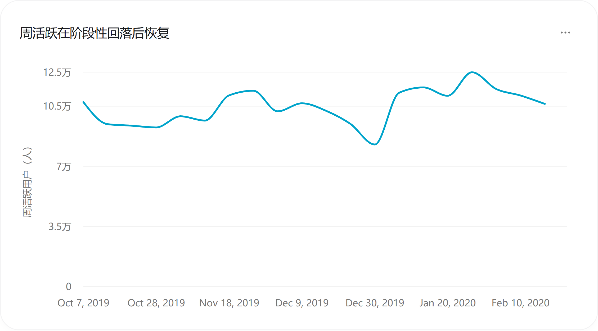
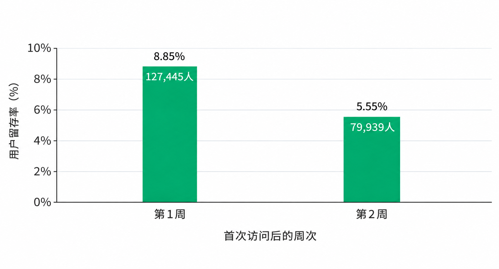
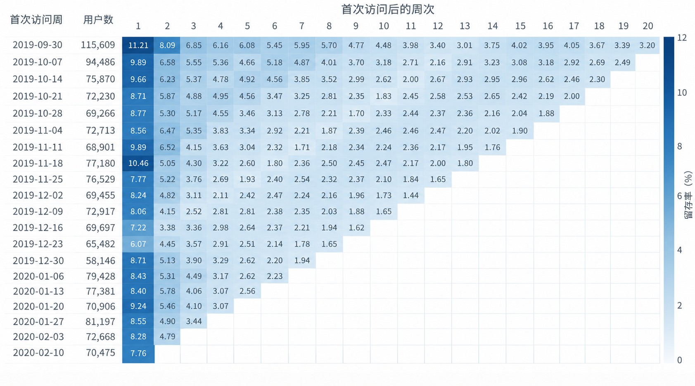
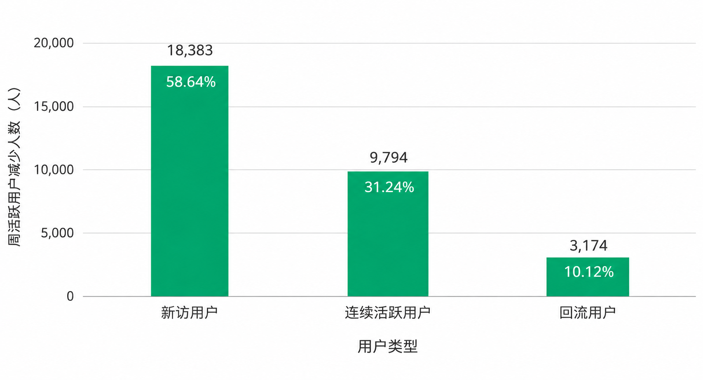

# 美妆电商用户运营分析

> 最终 Word 的可浏览文本及内嵌图片；完整排版以同目录 report.docx 为准。

美妆网店用户行为研究  2019年10月至2020年2月

## 一、总结简报

该美妆网店应优先改善商品查找与比较功能，并加强首访后两周的用户运营。本报告基于2019年10月至2020年2月的19,583,742条行为事件、1,639,358名用户，分析访问结构、购物转化和留存，为该网店的用户运营提供建议。

购物转化方面，网站产品与技术人员应先在重点类目试点属性筛选和商品比较。七天同商品路径中，浏览至加购率为17.54%，加购至购买率为29.96%。同类目两件高浏览商品的加购率为1.90%和8.01%，可据此确定首批核查范围。

新用户运营方面，应优先帮助首访周未购用户继续选购。新访用户占每周活跃的63.16%～87.94%。在同一组可完整观察两周的首访用户中，第1、2周留存率为8.85%和5.55%；其中首访周未购用户的第2周留存率为5.22%，低于已购用户的12.57%。

活跃恢复方面，推广运营人员应同时跟踪访问与购买。11月25日至12月30日两个端点周的活跃人数下降27.48%，新访和连续活跃减少合计贡献89.88%的降幅。1月6日当周活跃已恢复至112,880人，但购买用户占比仍比11月25日低1.78个百分点，应继续改善恢复入口的选购体验。

用户召回方面，可沿用已有行为分群，在连续1～2周未活跃的人群中试点低成本提醒。14个完整周内，在连续1～5周未活跃后返回的人次中，间隔1～2周的占64.87%。试点应同时配置继续选购页面，以额外购买及网店运营投入产出决定扩量。

建议由网店经营负责人确定试点商品、人群与预算，商品运营人员完善商品信息，网站产品与技术人员优化选购功能，用户运营人员配置回访提醒，数据分析人员评估购买、回访、成本和负反馈。这是按职能提出的分工建议，实际职责可由网店现有人员兼任。详细方案见第六章。

## 二、分析背景

网店需要同时管理用户进入、商品选择和后续回访。访问增加后购买是否同步增长，浏览商品后是否进入加购，首次到访的人是否再次回来，分别关系到流量、推荐和用户运营的投入方向。

样本内既有活跃人数的阶段性下降与恢复，也有同类商品加购表现和已购、未购用户留存的差异。本报告将这些结果连接起来，明确网店先改善哪些功能、优先服务哪些人群，以及如何判断措施是否值得推广。

## 三、分析目标与框架

### 3.1 分析目标

分析围绕三个问题展开。第一，访问波动主要来自新访、连续活跃还是回流用户。第二，购物路径中哪些环节涉及的未转化人数最多。第三，首访后第1、2周的回访表现如何，已购与未购用户有何差异。

报告据此确定网店的工作重点，包括商品查找与比较、新用户继续选购、近期未活跃用户召回，以及商品展示信息维护。每项建议明确负责职能、实施范围和结果指标。

### 3.2 分析框架

访问分析以完整自然周比较三类用户的人数变化。购物分析采用七天同商品行为漏斗，并补充已转化用户的购买耗时。留存分析按首次访问周分组，比较同一组用户首访后第1、2周的回访比例，再按首访周购买状态细分。

综合判断将活跃下滑分解、重点商品比较和回流间隔分布用于安排运营优先级。方案先在选定类目和人群中试点，再根据用户整体购买、回访及网店运营投入产出决定是否扩展。各模块的计算范围见第四章和附录。

## 四、数据释义

### 4.1 数据范围与字段含义

本项目使用公开的美妆电商用户行为数据（数据提供方：REES46），记录了一家中等规模美妆网店的浏览、加购、移出购物车和购买行为。数据覆盖2019年10月1日至2020年2月29日，时间统一按UTC解释。清洗后保留19,583,742条行为事件，涉及1,639,358名用户。周趋势采用2019年10月7日至2020年2月23日的20个完整自然周；回流间隔分析采用2019年11月18日至2020年2月23日的14个完整周。

用户编号用于识别行为主体，商品编号用于识别购物对象，类目编号用于辅助商品分组，事件时间用于确定先后顺序和归属周，事件类型用于区分浏览（view）、加入购物车（cart）、移出购物车（remove_from_cart）与购买（purchase）。事件价格为行为记录中的价格字段，不等同于实际支付金额。

数据包含用户、商品及其行为记录。解释访问波动、商品选择及购买变化时，还需补充网店的推广渠道、库存、配送和营销活动记录；若开展搜索或页面试验，则需记录曝光入口、展示位置和试验分组。现有数据没有商家层级字段。

### 4.2 用户分类与指标定义

新访用户：观察期内首次出现有效行为的用户；不等同于新注册或真实新客户。

连续活跃用户：本周与上周均有有效行为的用户；人数变化不等同于留存率变化。

周活跃用户次周留存率：上周活跃用户中，本周仍然活跃的比例；与按首次访问周分组的留存指标分母不同。

回访用户：首次出现后再次有有效行为的用户，按具体指标窗口统计；可覆盖连续活跃与回流，不能与两者直接相加。

回流用户：此前至少一个完整自然周未活跃，本周再次活跃的用户；描述行为，不代表受到营销触达。

待召回用户：按预先定义的未活跃条件选出的运营候选人群；本项目尚未提供完整人群规模，阈值不是已验证的流失标准。

用户召回：面向待召回人群实施的运营措施；需实际触达与对照证据才能判断增量。

用户留存：首次访问批次在目标自然周再次活跃的比例；不是复购率，也不要求连续每周活跃。

购买转化：本报告指定路径与时间窗内记录的购买行为；不能改称支付成功率或订单成交率。

购物漏斗采用同一用户、同一商品、严格时间顺序的路径，统一以首次浏览为七天窗口起点；路径判定后再按用户去重。转化耗时另以87,330名无窗口限制的严格转化用户为分母，不能与七天漏斗人数直接比较。自然周为UTC周一至周日，留存只纳入目标周具备完整观察机会的批次。

### 4.3 数据复核与解释边界

购物漏斗采用全量独立复核结果，留存采用MySQL只读导出与清洗事件重算的核对结果。访问趋势和回流分析基于清洗明细重建用户周。报告已纳入行为分群、首访周购买状态与留存的交叉结果，以及重点商品比较。运营试点属于下一阶段工作。

指标最小时间单位、统计对象和分母不同：全周期漏斗不能与单周活跃或批次留存直接相减；同商品严格路径不能覆盖全部购物方式；完整观察窗口不足的路径或批次按各模块规则排除。未知值与尚不可观察的留存格不记为零。

数据发布页将样本描述为一家中等规模美妆网店，具体店名及所在国家未在本项目中确认。本报告围绕该网店的商品体验和用户运营提出建议。阶段下滑采用人数差额分解，不能据此识别原因；搜索、展示及触达方案应通过后续对照试点评估。数据来源和具体口径见附录。

## 五、分析内容

本章依次分析活跃用户由哪些人群构成、购物路径在哪一步人数减少最多，以及首访后有多少人再次回来。分析结果分别对应访问恢复、商品选择和用户回访三个运营重点；用户进入网站的具体渠道仍需额外数据确认。

### 5.1 用户访问整体结构分析

周活跃经历下降和恢复，新访用户始终是主要组成。本节用20个完整自然周展示趋势，并按新访、连续活跃和回流人数解释构成变化。

5.1.1 周活跃的阶段性变化

周活跃在跨年周降至低点后，次周即恢复。11月25日当周为114,075人，12月30日降至82,724人，1月6日回升至112,880人，1月27日达到124,830人。另按周统计，11月18日有10,494名购买用户，高于黑色星期五所在周的8,622人，活动复盘应覆盖黑五前一周。

图1  来源：完整自然周的用户规模与构成。范围：2019-10-07 至 2020-02-23，20 个完整周。

5.1.2 访问用户的构成特征

每周活跃以新访用户为主，占比为63.16%～87.94%。三类用户互斥，人数合计为周活跃。这里的新访按观察期内首次出现识别，数据起点附近的分类受可追溯历史长度影响。

网店运营周报应同时列示三类用户人数，便于区分新增访问扩大与已有用户回访减少。运营资源据各类人数及购买表现安排，不能仅凭新访占比的升降调整投放。

图2  来源：完整自然周的用户规模与构成。范围：2019-10-07 至 2020-02-23，20 个完整周。

### 5.2 用户行为漏斗分析

浏览至加购涉及最多的未转化用户，应优先检查商品选择体验。本节先展示七天漏斗，再用已转化路径的耗时说明早期商品信息和后续提醒的安排。

5.2.1 购物路径与转化流失环节

正式漏斗以同一用户、同一商品在观察期内的首次浏览为起点，要求浏览、加购、购买时间严格依次发生，并在首次浏览起七天内完成。判定商品路径后再按用户去重，仅纳入有完整观察机会的路径。

| 漏斗阶段 | 去重用户数 | 相邻转化率 |
| --- | --- | --- |
| 浏览 | 1,529,295 | — |
| 加购 | 268,258 | 17.54% |
| 购买 | 80,366 | 29.96% |

图3  来源：7 天同商品购买漏斗。范围：2019-10-01 至 2020-02-29（UTC）。

浏览至加购是漏斗中人数减少最多的环节。1,529,295名浏览用户中，268,258人加购，80,366人完成七天同商品购买路径，总体转化率为5.26%。两个环节分别减少1,261,037人和187,892人。网店可先在高浏览、低加购商品所在类目试点筛选与比较功能。

补充路径允许用户在浏览后直接进入购买，覆盖88,980人，转化率为5.82%。其中包含主漏斗的80,366名购买用户。两种路径分别用于观察严格顺序转化和更宽的浏览后购买范围。

5.2.2 已转化用户的购买耗时分布

在87,330名不限制转化时间窗口的严格转化用户中，按每人最早完成购买的一条路径计算，首次浏览至购买的中位耗时约1.21小时；70.45%在一天内完成，85.43%在七天内完成，90.60%在十四天内完成，95.50%在三十天内完成。

网店应在商品浏览阶段提供规格、到手价和配送条件，帮助用户及时完成选择。在最终完成购买的用户中，70.45%在首次浏览商品后一天内购买。因此，网店应尽早展示商品规格、到手价和配送条件，帮助用户做出选择。购买提醒可先小范围试行，比较不同发送时间的效果，并持续跟踪后续购买，判断提醒是否带来了额外购买。

图4  来源：已转化用户的首次完成路径耗时。范围：2019-10-01 至 2020-02-29（UTC）。

### 5.3 用户留存特征分析

用户首次访问后，第2周回来的比例比第1周低。用户运营人员应重点做好首访后两周的回访提醒，并提供最近浏览和购物车入口，方便用户回来后继续挑选商品。

本节先展示不同首访周用户的后续回访情况，再比较同一组用户在首访后第1周和第2周的回访比例，最后说明为什么越往后的周次，能够纳入统计的用户越少。

5.3.1 首访后的早期留存表现

第1、2、4周留存率分别为8.80%、5.55%和3.80%，首访后前两周回访比例下降较快。用户按首次出现周进行分组，行为记录中出现浏览、加购、移出购物车或购买任一事件均计为活跃。目标周出现行为即计入该周留存。

图5  来源：自然周 Cohort 用户留存。范围：数据截至 2020-02-29（UTC）。

5.3.2 同一组首访用户的两周留存比较

同一组首访用户在第2周的回访比例比第1周低3.30个百分点。选取首访后两周均可完整观察的19组用户，共1,440,061人，第1周留存率为8.85%，第2周为5.55%。该比较固定了首访用户范围。

用户运营可据此将首访后两周列为提醒与继续选购功能的重点观察窗口。已购与未购用户的细分结果及运营方案见第6.2节。

图6  来源：同一批次集合的早期留存比较。范围：固定 19 个可观察批次。

5.3.3 不同批次与后段留存的比较

较晚周次主要反映更早首访用户的行为，其中第20周仅有最早一组用户具备完整观察机会。评估留存变化时，应比较相同首访范围与相同目标周。

图7按首次访问周和首访后周次展示留存。沿同一列可比较各组用户在首访后相同周次的表现，右下方空白表示相应周次尚不可观察。该图用于定位进一步复盘的用户组与时间段。

图7  来源：自然周 Cohort 用户留存。范围：数据截至 2020-02-29（UTC）。

## 六、核心结论与建议

该美妆网店应优先完善商品查找与比较，并围绕首访后两周开展用户运营。建议由网站产品与技术人员改善搜索和继续选购功能，用户运营人员安排回访与召回试点，商品运营人员维护商品信息。以下分别说明数据依据、建议行动和推广条件；实际分工由网店经营负责人结合现有人员安排。

### 6.1 完善商品筛选与比较功能

用户浏览后较少进入加购，可先选择重点美妆品类完善筛选和商品比较。浏览至加购是本次购物漏斗中用户减少最多的环节，仅17.54%的浏览用户在7天内将同一商品加入购物车。同类商品的浏览规模和加购差异可帮助确定信息核查范围，但不能直接证明页面功能或商品信息是低转化的原因。

网站产品与技术人员可与商品运营人员共同完善品类、用途、规格和价格筛选，统一展示商品规格、到手价及配送条件；涉及肤质、色号等美妆属性时，应先补齐准确资料。对有足够访问量的页面，在同一入口随机比较原版与改版，以全部入组用户7天内的整体购买率评估效果。商品排序调整也应通过试验验证，避免仅因历史加购率低就减少展示。

商品运营人员可先核查高浏览、低加购商品的标题、关键属性、图片、规格、价格、可售状态和服务信息，并由网店内部补齐缺失内容。同类商品采用一致的展示口径，再比较页面改动对购买表现的影响。由商品运营人员定期复查信息一致性。

### 6.2 优先经营首访后两周的未购用户

新访用户第2周回访比例下降，用户运营与网站产品人员应优先完善首访后两周的继续选购入口和提醒。新访用户占每周活跃的63.16%～87.94%。在同一组可完整观察两周的1,440,061名首访用户中，第1、2周留存率为8.85%和5.55%。

首访周未购用户规模较大，后续回访率也较低，用户运营与网站产品人员可优先验证购物车提醒和继续选购功能，帮助这类用户回访并完成观察期内的首次购买。该群体共137.58万人，首访后第1、2周的回访率分别为8.46%和5.22%；同期已购用户共6.42万人，对应回访率为17.30%和12.57%。

选择已加购、未购买且能够接收网店提醒的用户，由用户运营人员在首访后的第1周发送购物车提醒，网站产品人员提供最近浏览和购物车入口，网站产品与技术人员补充同类商品，方便用户继续挑选。试点采用随机分组，根据两周内的回访和购买表现评估效果。对首访当周已购买的用户，重点提供便捷的订单查询和售后服务。

### 6.3 加强新用户引流，促进老用户回访

针对新用户访问减少、老用户回访下降的问题，推广运营人员应优先恢复新用户访问，用户运营人员同步完善最近浏览和购物车入口，促进老用户回来继续选购。从2019年11月25日当周到12月30日当周，周活跃用户由114,075人降至82,724人，减少31,351人，降幅为27.48%。

| 用户类型 | 11月25日当周 | 12月30日当周 | 减少人数 | 降幅贡献 |
| --- | --- | --- | --- | --- |
| 新访用户 | 76,529 | 58,146 | 18,383 | 58.64% |
| 连续活跃用户 | 20,722 | 10,928 | 9,794 | 31.24% |
| 回流用户 | 16,824 | 13,650 | 3,174 | 10.12% |
| 合计 | 114,075 | 82,724 | 31,351 | 100.00% |

新访与连续活跃用户减少合计占总降幅的89.88%，应作为恢复活跃的重点。推广运营人员应围绕重点类目组织引流，网站产品与技术人员同步优化对应页面的类目导航和需求筛选，并跟踪新访人数及购买表现。

图8  周活跃用户减少人数及降幅贡献。范围：2019-11-25当周与2019-12-30当周；柱顶为减少人数，柱内为占总降幅的比例。来源：周活跃用户分类统计。

针对老用户次周回访减少的问题，用户运营人员应通过首页入口和适时提醒，方便用户查看最近浏览及购物车商品。2019年11月25日当周，上周活跃用户的再次访问比例为18.61%；12月30日当周降至11.54%。同期，上周活跃用户人数由111,360人降至94,689人。连续活跃用户共减少9,794人，其中约7,281人的减少对应次周回访比例下降，约2,513人对应上周活跃用户人数减少，运营应重点改善老用户再次访问的体验。

针对访问恢复后购买未同步恢复的问题，推广运营人员和网站产品与技术人员应同步优化推广内容与商品展示，以购买表现评估引流效果。2020年1月6日当周活跃用户为112,880人，已接近2019年11月25日的114,075人；但购买用户仅6,523人，少于此前的8,622人，购买用户占周活跃的比例由7.56%降至5.78%。网店应优先展示与推广内容一致的商品，并清楚呈现到手价、可售状态和配送条件，帮助用户完成选购。

### 6.4 优先召回连续1～2周未访问的用户

对连续1～2周未访问的用户，用户运营人员可先试点购物车和商品提醒，网站产品与技术人员提供最近浏览、购物车及同类商品入口。上线前应在触达起点重新计算每位用户的浏览、加购和购买状态，核验可触达人数；既有周活跃分群不能直接替代完整的召回名单。

2019年11月18日至2020年2月23日，连续1～5个完整自然周未访问后回流的用户，每周为10,567～15,798人，14周累计196,795人次。其中，间隔1～2周的为127,667人次，占64.87%。在这组历史回流记录中，较短间隔的回访较集中，可优先对近期未访问用户安排提醒试点。

为判断提醒是否带来更多购买，应按触达前的行为状态分群，在每个分群内随机设置提醒组和不发送提醒的对照组。数据分析人员按全部入组用户比较7天内的回访率和购买率，并跟踪14天累计购买，评估提醒带来的额外购买。两组采用相同起始日期和观察周期。

图9  连续1～5周未访问后回流的每周用户数。范围：2019-11-18至2020-02-23，14个完整自然周；每周按用户去重。来源：回流间隔统计。

图10  不同未访问间隔的累计回流人次及占比。范围同图9；柱顶为累计人次，柱内为占196,795人次的比例。来源：回流间隔统计。

为方便回访用户继续选购，网站产品与技术人员应在提醒链接打开的页面保留用户此前浏览或加购的商品，并提供同类选择；已购用户优先进入订单查询、售后服务或再次选购页面。用户运营人员按浏览、加购和已购分群配置消息内容与发送频次。

为控制召回成本，网店经营负责人应结合增量购买及毛利判断是否增加预算。运营人员需补充商品成本、优惠补贴、触达费用、退款、退订和投诉记录；行为事件中的价格不能直接当作实际收入或利润。若回访增加而购买未提升，可继续排查商品信息和选购页面。仅在增量毛利能够覆盖运营成本、用户负反馈可控时扩大试点。

附录  图表数据来源

图1与图2  用户访问趋势与结构

数据来源：clean_data.parquet、weekly_user_composition.csv。

统计范围：2019-10-07至2020-02-23，共20个完整自然周；时间统一按UTC周一至周日划分。浏览、加购、移出购物车或购买任一事件均计为活跃，每位用户每周去重一次。

分类规则：新访用户为观察期内首次出现的用户；连续活跃用户为本周和上周均活跃的用户；回流用户为至少一个完整自然周未活跃、本周再次活跃的用户。三类互斥，合计为周活跃人数。新访按数据内首次出现识别，与注册人数口径不同。

图3  七天同商品浏览、加购与购买漏斗

数据来源：metric_dictionary.md、funnel_counts.csv、funnel_rates.csv。

路径规则：同一用户对同一商品首次浏览后，严格依次发生加购与购买，均在该次浏览起7天内完成；仅纳入具备完整7天观察机会的商品路径，路径判定后再按用户去重。

指标核对：浏览用户1,529,295人，加购用户268,258人，购买用户80,366人；浏览至加购率17.54%，加购至购买率29.96%，浏览至购买率5.26%。购买指purchase行为记录，统计单位为用户。正文补充的浏览后购买路径允许跳过加购，覆盖88,980人，转化率5.82%，其中包含严格路径购买用户。

图4  首次浏览至购买的累计完成比例

数据来源：first_strict_duration.csv、first_strict_coverage.csv、metric_dictionary.md。

统计范围：在全观察期内完成同商品浏览、加购、购买路径的87,330名用户，每人取最早完成购买的一条路径，计算从该路径首次浏览到购买的耗时；此处不限制为7天内完成。中位耗时为4,338秒，约1.21小时。

图中1、7、14、30天内累计完成购买的用户分别为61,520、74,608、79,119、83,403人，占87,330人的70.45%、85.43%、90.60%、95.50%。比例分母均为已完成该路径的用户；与图3的7天路径筛选范围不同。

图5与图7  首访后留存曲线与分组热力图

数据来源：overall_exact.csv、retention_detail_exact.csv、核对说明.md。

统计规则：按用户在观察期内首次出现的自然周分组。首访周为第0周，之后第N个自然周出现任一有效行为即计入第N周留存，分母为该首访组的用户数。每个目标周只纳入可以完整观察该周的首访组。

图5为各目标周合格首访组的合并留存率，按各组用户人数加权计算。第1、2、4周分别纳入20、19、17组用户，留存率为8.80%、5.55%、3.80%；各周纳入的首访范围随观察时长变化。第20周仅纳入最早一组115,609名用户，其中3,702人回访，留存率为3.20%。

图7展示2019-09-30至2020-02-10起始的20个首访周；每格以该行用户数为分母，单元格数字及色阶单位均为%。右下方空白表示相应目标周尚无完整观察机会。首组按2019-09-30所在自然周归组，实际数据自2019-10-01开始。

图6及第6.2节  同一组首访用户的两周回访与购买状态

数据来源：retention_detail_exact.csv、interpretation_calculations.json；首访周购买状态与后续回访交叉结果依据clean_data.parquet计算。

固定范围：首次出现周为2019-09-30至2020-02-03的19组用户，共1,440,061人，均可完整观察首访后第1、2周。两周回访人数分别为127,445人和79,939人，留存率为8.85%和5.55%，相差3.30个百分点。两周分别统计回访，回访者不要求相同。

已购与未购以首访周结束时的购买状态划分。未购用户1,375,845人，第1、2周回访率为8.46%和5.22%；已购用户64,216人，对应为17.30%和12.57%。正文137.58万人和6.42万人按万人为单位，四舍五入保留两位小数。

图8及第6.3节  周活跃减少构成与购买恢复

数据来源：decline_decomposition.csv、weekly_user_composition.csv；周购买人数核对采用weekly_purchase_verified_complete_weeks.csv。

比较范围：2019-11-25当周与2019-12-30当周，周活跃由114,075人降至82,724人，总减少31,351人，降幅27.48%。新访、连续活跃、回流用户分别减少18,383、9,794、3,174人，占总减少人数的58.64%、31.24%、10.12%。图8柱高及柱顶数字为减少人数，柱内数字为降幅贡献。

连续活跃分解：两个比较周对应的上周活跃人数为111,360人和94,689人，次周回访比例为18.61%和11.54%。以另一项的两期平均值为权重，分别计算人数基数与回访比例变化的影响，得到约2,513人与7,281人，合计约9,794人。该结果用于说明人数基数和回访比例各自对应的变动。

购买对比：周购买用户指自然周内出现purchase记录的去重用户，购买任意商品均计入；购买用户占比的分母为当周活跃用户。2019-11-25当周购买8,622人，占7.56%；2020-01-06当周购买6,523人，占5.78%，相差1.78个百分点。该指标与七天严格同商品漏斗的购买率分别统计。

图9与图10及第6.4节  用户回流规模与未访问间隔

数据来源：return_gap_1to5_recomputed.csv、story_evidence.json。

统计范围：2019-11-18至2020-02-23，共14个完整自然周。用户本周再次活跃时，计算与此前最近活跃周之间完整未活跃的自然周数，仅纳入间隔1～5周的回流记录。图9每周按用户去重，人数为10,567～15,798人；横轴日期为各自然周的周一。

图10按未访问间隔汇总14周记录。间隔1、2、3、4、5周分别为82,101、45,566、29,768、22,110、17,250人次，合计196,795人次；对应占比为41.72%、23.15%、15.13%、11.24%、8.77%。间隔1～2周共127,667人次，占64.87%。

跨周合计采用人次口径：同一用户在不同周回流时分别计入。图10柱高及柱顶为累计人次，柱内为各间隔占196,795人次的比例。所有占比均以1～5周间隔的回流记录为分母。历史回流记录用于选择召回试点范围，提醒效果由随机对照试点评估。

第6.1节补充比较与资料定位

重点商品比较按全期浏览事件数选择前六件商品，再按各商品首次浏览和完整7天观察机会统计加购与购买；每件商品分别按用户去重，同一用户可出现在不同商品的统计中。相同类目、浏览用户数接近的商品加购率为1.90%和8.01%，差异为6.11个百分点，用于安排信息核查与展示试点。

项目资料位置：基础清洗数据位于data/processed/clean_data；漏斗结果位于data/analysis_output/funnel_20260922/verification；留存结果位于data/analysis_output/weekly_retention_validation_20261020；周购买核对结果位于data/analysis_output/status_archive_20261026/purchase。weekly_user_composition.csv、decline_decomposition.csv、return_gap_1to5_recomputed.csv及story_evidence.json存于业务故事复核资料目录，项目归档目录report_evidence中保留同版副本。

数据发布来源与网店应用说明

REES46数据目录：Cosmetics，2019年10月至2020年2月。https://rees46.com/en/datasets

公开数据来自一家中等规模美妆网店（数据提供方：REES46），具体店名及所在国家未在本项目中确认。REES46为数据提供方，数据说明不据此推断网店的隶属或入驻关系。运营建议适用于该网店的商品展示、选购体验及用户回访；试点还需补充曝光、触达、成本和试验分组记录。发布页：https://www.kaggle.com/datasets/mkechinov/ecommerce-events-history-in-cosmetics-shop

方法参考：贝恩与Worldpanel《渠道破局：中国快消品市场的机会和挑战》第4页，以及普华永道《2025年消费者之声全球调研——中国报告》第10～12页，用于指标拆解与经营场景表达。正文的用户人数、比率和时间变化均来自本项目行为数据。
